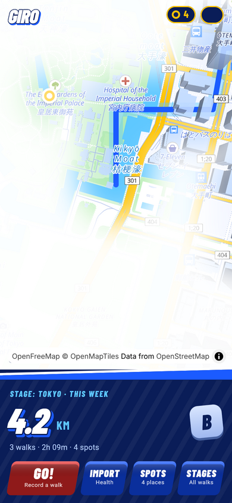
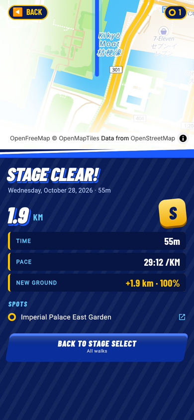
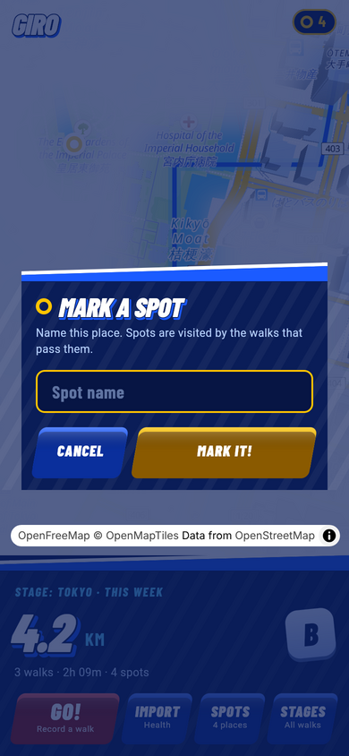
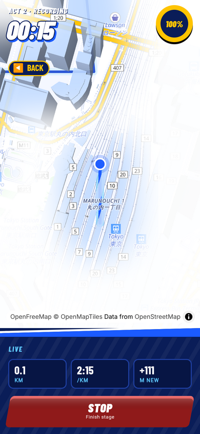

# giro

Run dev

```bash
$ flutter run --flavor dev -t lib/main_dev.dart
```

Run prod

```bash
$ flutter run --flavor prod -t lib/main_prod.dart
```

## Design

The UI is a Sonic Generations-style game HUD (`lib/design/sonic/`, Barlow
Condensed bundled under `assets/fonts/`, SIL OFL). Walks are stages, saved
places are spots, the week's distance is the score, and every walk gets a
rank (S/A/B/C) from how much *new ground* it covered: the share of its
points farther than 60 m from any earlier walk (`SonicStats`). Two more
explorations (Zenly × Apple and the Sonic concept itself) live in
`docs/design/giro-concepts.html`.

| Home | Stage select | Stage clear |
|---|---|---|
|  |  |  |

| Spots | Mark a spot | Recording |
|---|---|---|
|  |  |  |

The PNGs are half-size copies of `tool/web_screenshots.mjs` output.

## Map

The map is [MapLibre](https://maplibre.org) on [OpenFreeMap](https://openfreemap.org)
tiles (OpenMapTiles data, free, no API key), styled in the Sonic palette:
`assets/map/sonic_style.json` is OpenFreeMap's Liberty style recoloured by
`tool/make_sonic_style.py`. Walks are injected into the style as a GeoJSON
source with a glow and a line layer (`GiroMapStyle`), so MapLibre draws them
in the same frame as the base map.

On iOS and Android the map is rendered by
[maplibre_flutter_gpu](https://pub.dev/packages/maplibre_flutter_gpu): MapLibre
Native does the tiles and style, Flutter GPU does the drawing, and there is no
platform view. That is why the fog of war, the 3D buildings and the spot
markers can be drawn inside the map's own frame without lag.

The package is vendored as a small fork in `packages/maplibre_flutter_gpu`
(see `GIRO.md` there). Its MapLibre Native binaries are not in git; after
cloning, run

```bash
$ tool/fetch_maplibre_native.sh
```

once (Codemagic does it before `flutter pub get`). iOS needs
`FLTEnableFlutterGPU` in `Info.plist` and iOS 15.5; Android needs API 29.

The Dart side finds the MapLibre Native functions with
`DynamicLibrary.process()`, which reads the app executable's export table.
Xcode's default *Strip Style* ("All Symbols") removes that table from
release archives, so every Runner configuration sets
`STRIP_STYLE = non-global` (Flutter's rule for FFI plugins). Without it a
TestFlight build fails with "Failed to lookup symbol
'maplibre_session_create'".

## Fog of war

The map starts out white. Every walk (and every saved spot) uncovers the
colourful map underneath along its path, with a soft edge, so the city fills
in as you explore it. Pass `fogOfWar: false` to `PlatformMapView` to opt out
on a screen.

- `ExploredMask` (`lib/core/map/explored_mask.dart`) rasterises where the
  user has been once, in Web Mercator space, with the reveal radius in
  metres. It is rebuilt only when walks or spots change.
- On iOS/Android `FogGpu` draws one full-screen quad per frame inside the
  MapLibre frame (`shaders/fog.frag`): each pixel is unprojected onto the
  ground with the camera matrix and looked up in the mask. With the fork's
  `gpuOverlayReadsMapColor` the shader also sees the finished map, so
  unexplored ground is rendered as a pale sketch of the map rather than a
  flat white blend.
- `ExploredBuildings` replaces the fragment shader of the `building-3d`
  layer (`shaders/explored_building.frag`): buildings are white blocks until
  the walk passed them, then keep their colour.
- On the web and in tests the canvas `FogOfWar` overlay draws the same mask
  with one `dstOut` image draw per camera move.

Shaders under `shaders/` are compiled by `hook/build.dart` with the Flutter
SDK's `impellerc` into `assets/shaderbundles/` at build time.

## Web preview

The app is iOS-first, but `lib/main_web.dart` runs it in a browser with the
native-only packages swapped for mocks from `lib/web_mocks/`:

| Native dependency | Web replacement |
|---|---|
| `mmkv` storage | `InMemoryWalkRoutesRepo` / `InMemoryPoiRepo` seeded with sample Tokyo walks |
| HealthKit method channel | `MockHealthkitRepo` returning canned workouts |
| `geolocator` | `MockGeolocatorPlatform` walking along a fixed loop |
| `maplibre_flutter_gpu` map | MapLibre GL JS (`WebMapLibreMap`, loaded in `web/index.html`) showing the same style and walk layers; `?map=mock` switches to `MockPlatformMap`, a canvas-drawn map with markers, polylines, pan/zoom and long press |
| `map_launcher` installed apps | `MockLaunchableMapsRepo` (Apple + Google Maps "installed") |

```bash
# Interactive
$ flutter run -d chrome -t lib/main_web.dart
# Headless server (e.g. inside a container)
$ flutter run -d web-server -t lib/main_web.dart --web-port 8080
```

Append `?style=material` to the URL for Material page transitions instead of
Cupertino ones, and `?map=mock` to swap the MapLibre map for the canvas mock.
Right-click on the web map stands in for a long press.

### Screenshots

`tool/web_screenshots.mjs` walks through the main screens with Playwright's
Chromium and writes PNGs to `build/web_screenshots/`:

```bash
$ flutter build web -t lib/main_web.dart
$ node tool/web_screenshots.mjs            # or --url http://localhost:8080/
```

The same mocks back the widget tests in `test/web_mocks/`, so `flutter test`
exercises the real screens on any desktop platform.
