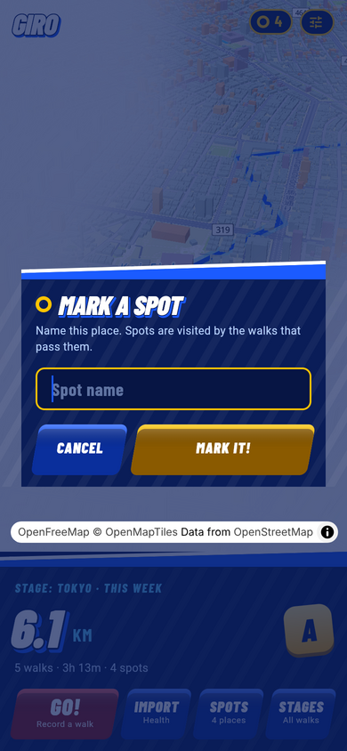
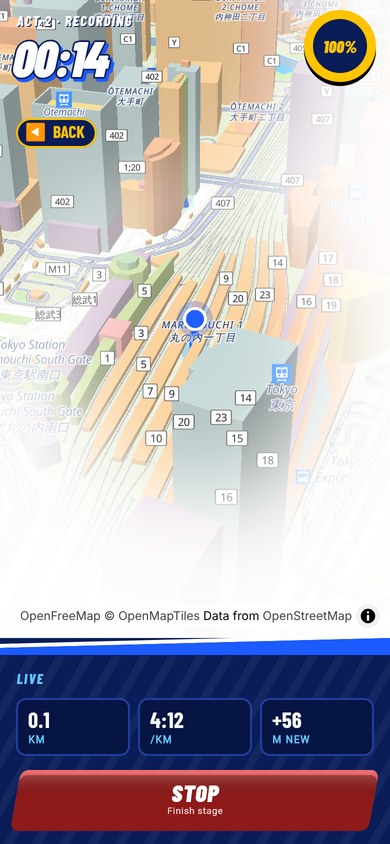
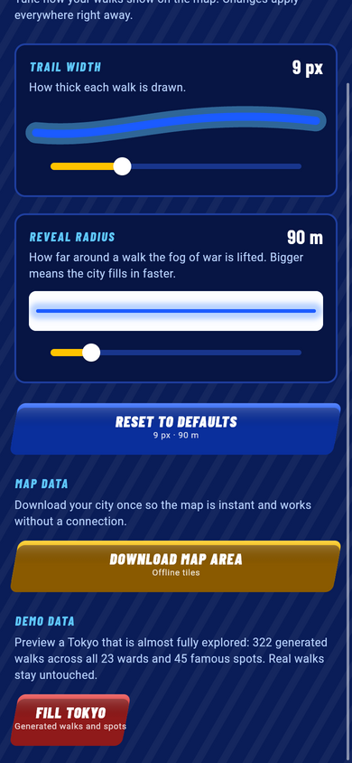
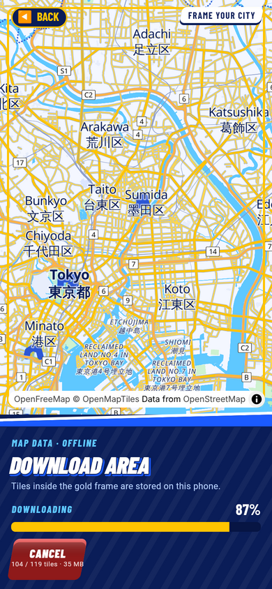
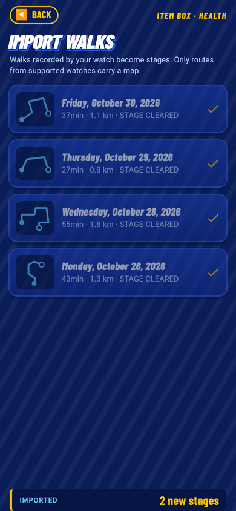
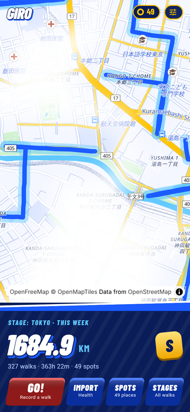
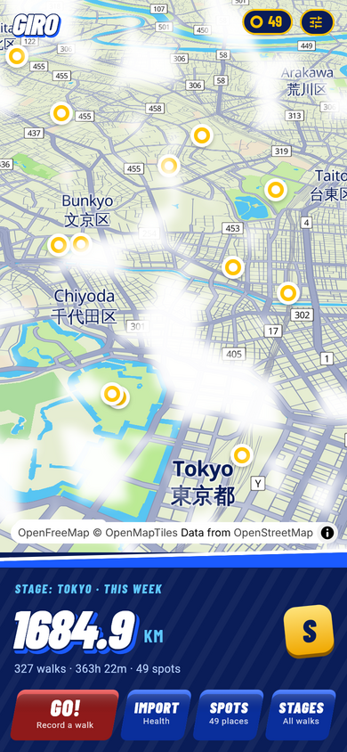
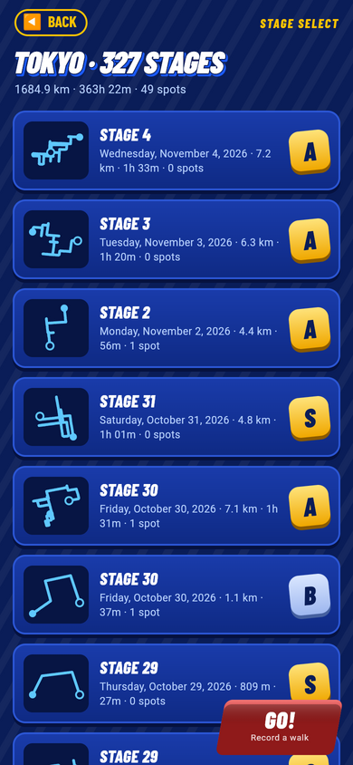

# giro

Run dev

```bash
$ flutter run --flavor dev -t lib/main_dev.dart
```

Run prod

```bash
$ flutter run --flavor prod -t lib/main_prod.dart
```

## Design

The UI is a Sonic Generations-style game HUD (`lib/design/sonic/`, Barlow
Condensed bundled under `assets/fonts/`, SIL OFL). Walks are stages, saved
places are spots, the week's distance is the score, and every walk gets a
rank (S/A/B/C) from how much *new ground* it covered: the share of its
points farther than 60 m from any earlier walk (`SonicStats`). Two more
explorations (Zenly × Apple and the Sonic concept itself) live in
`docs/design/giro-concepts.html`.

| Home | Stage select | Stage clear |
|---|---|---|
|  |  |  |

| Spots | Mark a spot | Recording |
|---|---|---|
|  |  |  |

| Options | Map download | Import everything |
|---|---|---|
|  |  |  |

| Demo: street zoom | Demo: city zoom | Demo: 327 stages |
|---|---|---|
|  |  |  |

The PNGs are half-size copies of `tool/web_screenshots.mjs` output.

## Map

The map is [MapLibre](https://maplibre.org) on [OpenFreeMap](https://openfreemap.org)
tiles (OpenMapTiles data, free, no API key), styled in the Sonic palette:
`assets/map/sonic_style.json` is OpenFreeMap's Liberty style recoloured by
`tool/make_sonic_style.py`. Walks are injected into the style as a GeoJSON
source with a glow and a line layer (`GiroMapStyle`), so MapLibre draws them
in the same frame as the base map.

On iOS and Android the map is rendered by
[maplibre_flutter_gpu](https://pub.dev/packages/maplibre_flutter_gpu): MapLibre
Native does the tiles and style, Flutter GPU does the drawing, and there is no
platform view. That is why the fog of war, the 3D buildings and the spot
markers can be drawn inside the map's own frame without lag.

The package is vendored as a small fork in `packages/maplibre_flutter_gpu`
(see `GIRO.md` there). Its MapLibre Native binaries are not in git; after
cloning, run

```bash
$ tool/fetch_maplibre_native.sh
```

once (Codemagic does it before `flutter pub get`). iOS needs
`FLTEnableFlutterGPU` in `Info.plist` and iOS 15.5; Android needs API 29.

The Dart side finds the MapLibre Native functions with
`DynamicLibrary.process()`, which reads the app executable's export table.
Xcode's default *Strip Style* ("All Symbols") removes that table from
release archives, so every Runner configuration sets
`STRIP_STYLE = non-global` (Flutter's rule for FFI plugins). Without it a
TestFlight build fails with "Failed to lookup symbol
'maplibre_session_create'".

## Ranks without the lag

Every stage's rank comes from how much of it was new ground: points farther
than 60 m from any earlier walk. `ExploredIndex` buckets every coordinate of
every walk into a 60 m grid once per list of walks, so a rank is a few cell
lookups per point instead of a scan of every other walk. Stage select,
stage clear and the live recording HUD all share it. Route thumbnails
(`RoutePreview`) thin long walks, cache their path and sit in a repaint
boundary.

## Options

The tune icon on the home HUD opens Options (`SonicOptionsPage`): two
sliders, **trail width** (how thick walks are drawn, 3 to 24 px) and
**reveal radius** (how far around a walk the fog lifts, 30 to 400 m), with a
live preview of each. They are `MapSettings`, persisted in MMKV and provided
app-wide by `MapSettingsCubit`, so every map reacts at once.

## Map data (offline)

The map's vector tiles go through an on-device cache, `TileCacheHttp`: a
loopback HTTP server the map loads `/tiles/{z}/{x}/{y}.pbf` from. Cached
tiles are served from disk, missing ones are fetched from OpenFreeMap once
and kept, so a city is only ever downloaded a single time and the map works
offline afterwards. The OpenFreeMap tile URL (its dated path changes weekly)
is resolved from their TileJSON and remembered for offline starts. Sprites
and font glyphs are mirrored through the same cache, so a start with
everything stored needs no network.

"Download area" (first launch, and Options > Download map area) stores every
tile of the framed area for zoom 0 to 14, which is all OpenFreeMap serves,
with a progress bar, tile and size estimates, and OpenFreeMap's 3000-tile
limit enforced. `NSAllowsLocalNetworking` in `Info.plist` lets the map talk
to the loopback server. On the web the map loads from OpenFreeMap directly
and `MockTileStore` simulates the download.

## Import everything

Besides picking from the 25 most recent walks, the Health item box can
import the whole history: `HealthkitCubit.retrieveAll` pages through
HealthKit 25 workouts at a time (the method channel takes `limit` and
`before`), saving each page's new walks as stages while a counter shows
progress.

## Demo data

Options > Demo data > **Fill Tokyo** adds 322 generated walks across all 23
wards plus 45 famous spots (`TokyoDemoData`), to preview the app with most
of the city explored: Manhattan-style strolls of 2 to 9 km with GPS jitter,
dated over the last two years. They come from a fixed seed, so **Remove
demo data** deletes exactly those walks again and leaves real ones alone.

## The toy city

The reference for the look is **Anywhere — Your only map** by Fenn AI
(https://apps.apple.com/jp/app/anywhere-your-only-map/id6823839358): a
miniature globe that zooms into detailed, pastel 3D street scenes with
windows, trees, cars and landmark models, rendered by their own engine
with their own geometry and terrain materials (their credits page says so),
and with its own fog that lifts as you explore. Giro aims for the same
experience in the uncovered areas, built from the OpenStreetMap data in the
tiles:

- **Camera:** every map opens tilted (`SonicMap.tilt`, 55°), like a model on
  a table. 3D buildings are always on.
- **Buildings:** OSM footprints extruded by `render_height`, each coloured
  from a pastel palette by its OSM id (`tool/make_sonic_style.py`), so
  neighbours differ. On iOS `ToyBuildings` replaces the fragment shader of
  the `building-3d` layer with `shaders/toy_building.frag`: a procedural
  window grid (3.2 m bays, 3.4 m storeys, a quarter of them lit warm), a warm
  key light and lighter roofs. Unexplored buildings are white clay with the
  same shading; the per-vertex explored value comes from the fog mask.
- **Ground:** grassy land, soft asphalt roads with white dashed centre lines
  on the bigger streets, vivid parks, bright water, warm directional light.
- **Post-process (iOS):** the fog pass also applies a tilt-shift blur at the
  top and bottom of the frame, a touch of saturation and warmth, and a soft
  vignette (`shaders/fog.frag`).

Next in this direction: low-poly trees in parks and along streets, and
landmark models at spots, both through the map's GPU mesh callback.

## Fog of war

The map starts out white clay. Every walk (and every saved spot) uncovers
the colourful city underneath along its path, with a soft edge, so Tokyo
fills in as you explore it. Pass `fogOfWar: false` to `PlatformMapView` to
opt out on a screen.

- `ExploredMask` (`lib/core/map/explored_mask.dart`) rasterises where the
  user has been once, in Web Mercator space, with the reveal radius in
  metres. It is rebuilt only when walks or spots change.
- On iOS/Android `FogGpu` draws one full-screen quad per frame inside the
  MapLibre frame (`shaders/fog.frag`): each pixel is unprojected onto the
  ground with the camera matrix and looked up in the mask. With the fork's
  `gpuOverlayReadsMapColor` the shader also sees the finished map, so
  unexplored ground is rendered as near-white clay (a faint trace of the
  map stays for orientation) and explored ground keeps its colours.
- On the web and in tests the canvas `FogOfWar` overlay draws the same mask
  with one `dstOut` image draw per camera move (top-down projection only).

Shaders under `shaders/` are compiled by `hook/build.dart` with the Flutter
SDK's `impellerc` into `assets/shaderbundles/` at build time.

Walk lines are only the full chosen width at street zoom (16+); they thin
out from there and fade away below zoom 13.5, so at city scale an explored
district reads as coloured city on white clay rather than a tangle of lines.

## Web preview

The app is iOS-first, but `lib/main_web.dart` runs it in a browser with the
native-only packages swapped for mocks from `lib/web_mocks/`:

| Native dependency | Web replacement |
|---|---|
| `mmkv` storage | `InMemoryWalkRoutesRepo` / `InMemoryPoiRepo` seeded with sample Tokyo walks |
| HealthKit method channel | `MockHealthkitRepo` returning canned workouts |
| `geolocator` | `MockGeolocatorPlatform` walking along a fixed loop |
| `maplibre_flutter_gpu` map | MapLibre GL JS (`WebMapLibreMap`, loaded in `web/index.html`) showing the same style and walk layers; `?map=mock` switches to `MockPlatformMap`, a canvas-drawn map with markers, polylines, pan/zoom and long press |
| `map_launcher` installed apps | `MockLaunchableMapsRepo` (Apple + Google Maps "installed") |

```bash
# Interactive
$ flutter run -d chrome -t lib/main_web.dart
# Headless server (e.g. inside a container)
$ flutter run -d web-server -t lib/main_web.dart --web-port 8080
```

Append `?style=material` to the URL for Material page transitions instead of
Cupertino ones, and `?map=mock` to swap the MapLibre map for the canvas mock.
Right-click on the web map stands in for a long press.

### Screenshots

`tool/web_screenshots.mjs` walks through the main screens with Playwright's
Chromium and writes PNGs to `build/web_screenshots/`:

```bash
$ flutter build web -t lib/main_web.dart
$ node tool/web_screenshots.mjs            # or --url http://localhost:8080/
```

The same mocks back the widget tests in `test/web_mocks/`, so `flutter test`
exercises the real screens on any desktop platform.
